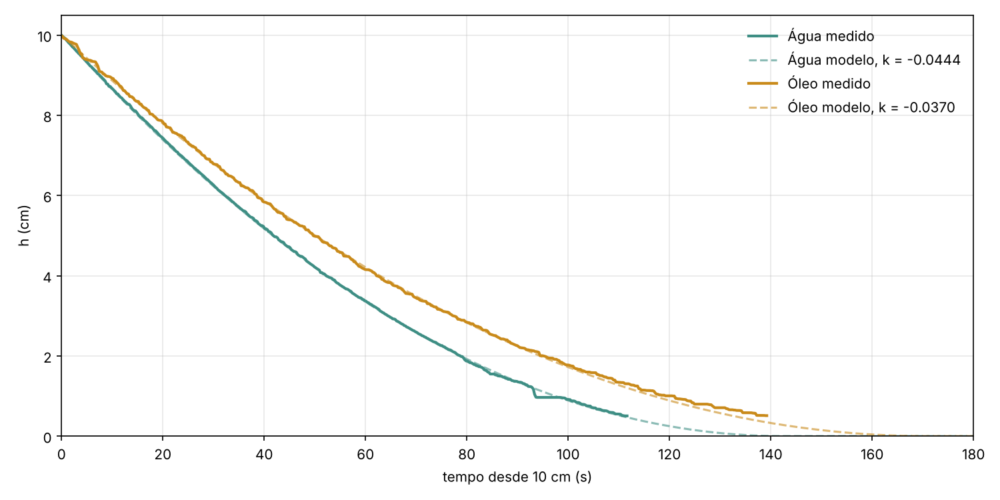
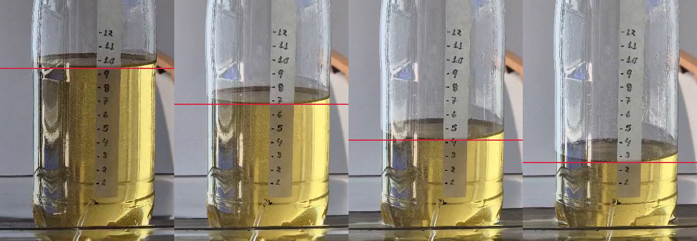

# Análise dos vídeos: do vídeo ao k

Pipeline que lê o nível do líquido nos vídeos do experimento da garrafa (água e óleo),
quadro a quadro, e ajusta a constante `k` do modelo

$$\frac{dh}{dt} = k\sqrt{h} \quad\Rightarrow\quad h(t) = \left(\sqrt{h_0} + \tfrac{k}{2}\,t\right)^2$$

## Resultados

| | 10 → 3 cm | k (dois pontos) | k (mínimos quadrados) | R² de √h × t |
|---|---|---|---|---|
| Livro (questão 2a) | 68 s | −0,042 | — | — |
| Água | 64,4 s | −0,044 | −0,044 | 1,0000 |
| Óleo | 77,3 s | −0,037 | −0,037 | 0,9998 |

`h` em cm e `t` em s. A água repete o valor do livro; o óleo, na mesma garrafa
com o mesmo furo, tem |k| cerca de 17% menor e esvazia mais devagar.
Tempos por marca em [`dados/tempos_por_marca.csv`](dados/tempos_por_marca.csv).



## Como rodar

```bash
pip install -r requirements.txt      # e o ffmpeg: brew install ffmpeg
python run.py --sem-video            # refaz o ajuste a partir dos níveis já extraídos (dados/*_nivel.csv)
python run.py                        # processa os vídeos do zero (coloque-os em videos/agua.mp4 e videos/oleo.mp4)
python -m pytest tests               # testes do ajuste com dados sintéticos
```

Os vídeos não estão no repositório (≈100 MB). Os níveis extraídos estão em `dados/`,
então o ajuste roda sem eles.

## Método

1. **Calibração (pixel → cm).** Os traços da fita aparecem como picos escuros numa coluna
   estreita da imagem. Uma reta ajustada às 12 marcas dá a escala (≈ 24,8 px/cm; resíduo
   máximo de 0,05 cm).
2. **Detecção da borda.** Em cada quadro (4 por segundo), procura-se a borda do líquido
   em faixas verticais ao lado da fita: na água, a transição da faixa escura da superfície
   para a água clara; no óleo, o início do amarelo.
3. **Correção da perspectiva.** A câmera fica um pouco acima do líquido, então a superfície
   aparece como uma elipse, e a borda da frente sobe à medida que se afasta do centro da garrafa.
   Medir só ao lado da fita superestimava o nível. Por isso, a borda é medida em 6 a 7 colunas e
   extrapolada por uma parábola `y = y0 + c·(x − xc)²` até a coluna da fita, com rejeição de outliers.
4. **Limpeza.** Filtro de mediana (janela de 9 quadros) para picos isolados e regressão isotônica
   decrescente, porque o nível não pode subir.
5. **Ajuste.** `t = 0` é o instante em que o nível cruza 10 cm. O `k` sai do tempo de 10 a 3 cm
   (a mesma conta da questão 2a) e, como checagem, de uma reta de mínimos quadrados em √h × t.
   R² ≈ 1 indica que o modelo √h descreve bem os dados.
6. **Validação visual.** `figuras/validacao_*.png` desenha o nível detectado sobre quadros do vídeo.



## Limitações

- Abaixo de ~1,3 cm, a medida da água perde confiabilidade: o nível entra na base ondulada da
  garrafa. Os resultados usam o trecho de 10 a 2 cm.
- Uma rodada por fluido; repetições dariam a margem de erro.
- As coordenadas em `config.json` valem para estes vídeos (480 × 854). Outro vídeo precisa de
  novas colunas e um novo quadro de calibração.

## Estrutura

```
config.json          parâmetros de cada vídeo (colunas, detector, centro da garrafa)
run.py               executa o pipeline completo
pipeline/
  video.py           leitura de quadros via ffmpeg
  calibracao.py      marcas da fita → escala pixel/cm
  nivel.py           detecção da borda + extrapolação parabólica
  limpeza.py         mediana + regressão isotônica
  modelo.py          modelo √h, cruzamentos e ajuste de k
tests/               testes com dados sintéticos de k conhecido e a tabela da questão 2(a)
dados/               níveis extraídos, calibração, resultados
figuras/             gráfico h × t e validações
```
